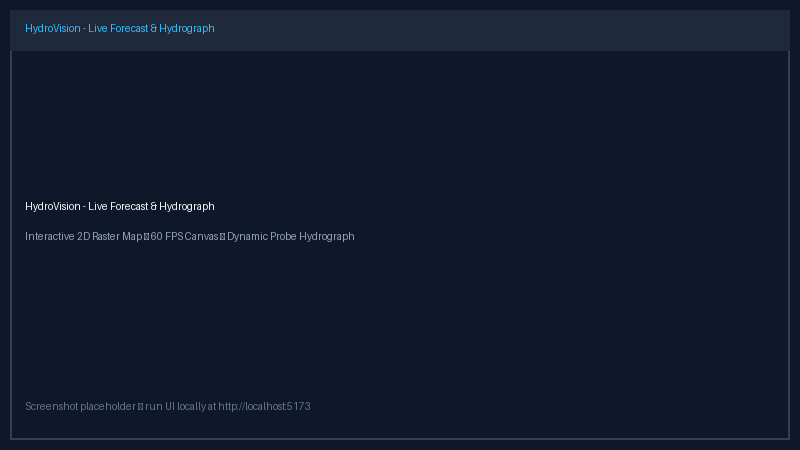
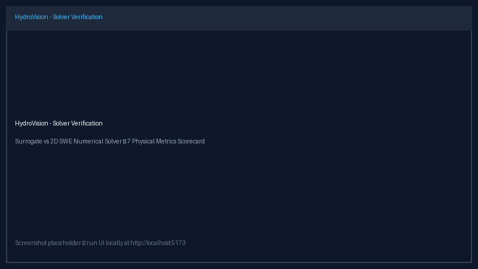
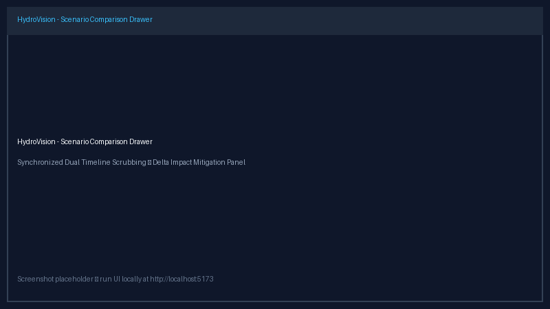
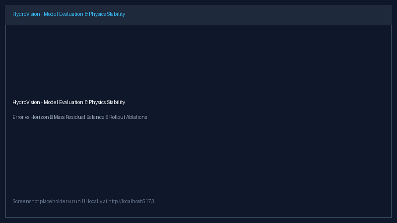

# HydroVision — Urban Flood Forecasts in Seconds, Not Hours

[](https://www.python.org/downloads/)
[](https://fastapi.tiangolo.com/)
[](https://reactjs.org/)
[]()
[]()

HydroVision is an edge-accessible, physics-informed neural surrogate framework that simulates 2 hours of urban street flood dynamics in under 50 milliseconds. By coupling high-resolution digital topography with deep autoregressive learning and hard physical mass-conservation constraints, HydroVision transforms heavy computational fluid dynamics into instantaneous visual intelligence for city planners, first responders, and municipal engineers.

- **USP 1**: Predicts 2D overland flood propagation in ~38 ms on CPU right on an interactive map.
- **USP 2**: Proves every forecast side-by-side against a full 2D Shallow Water Equations solver.
- **USP 3**: Features scenario "What-If" saving, delta impact panels, and offline demo fallback resilience.

---

## ⚡ One-Command Run

Start both the FastAPI backend (port 8000) and the React + Vite frontend (port 5173) with a single command:

```bash
# Clone and enter repo
git clone https://github.com/Hunter-of-pros/HydroVision.git
cd hydrovision

# Install Python & Node dependencies
make setup
make frontend-install

# Launch both servers concurrently
./scripts/dev.sh
# or run: make dev
```

Once running:
- **Interactive UI Dashboard**: [http://localhost:5173](http://localhost:5173)
- **FastAPI OpenAPI Swagger Docs**: [http://localhost:8000/docs](http://localhost:8000/docs)
- **Backend API Health Check**: [http://localhost:8000/health](http://localhost:8000/health)

Press `Ctrl+C` to cleanly shut down both servers.

---

## 🏗️ System Architecture

```mermaid
flowchart TD
    subgraph UI ["Frontend Client (React 18 + Vite + Tailwind CSS)"]
        A[Interactive Rainfall & Drain Controls] -->|Debounced 300ms + AbortController| B(Live Canvas MapViewer)
        B --> C[Point Probe & Inundation Inspector]
        A --> D[Run History Drawer & What-If Compare]
        A --> E[Evaluation Tab Benchmark Visualizer]
    end

    subgraph API ["FastAPI Serving Gateway (Port 8000)"]
        F["POST /forecast (3-Dec Rounding, GZip)"]
        G["POST /compare (Dual Rollout & 7 Metrics)"]
        H["GET /health (Mock / Real Degraded Status)"]
        I["GET /terrain, /config, /presets, /results"]
    end

    subgraph ENGINE ["HydroVision ML Package"]
        direction TB
        MODE{HYDRO_MODE}
        MODE -->|mock (Default)| MOCK[Mock Engine: Synthetic DEM & Analytical Spreader]
        MODE -->|real| REAL[Real Pipeline: best.pt & SWE Solver]
        
        REAL --> SURR[Neural Surrogate Model ~38ms CPU]
        REAL --> SOLV[2D SWE Local-Inertial Solver ~1.5s]
        
        SURR --> METRICS[Formal Accuracy & Conservation Metrics]
        SOLV --> METRICS
    end

    subgraph FALLBACK ["Client-Side Resilience"]
        OFFLINE[frontend/public Offline Reference Fixtures]
    end

    UI -->|REST JSON + GZip| API
    API --> ENGINE
    API -.->|Network Drop or 5xx| OFFLINE
    OFFLINE -.->|Auto-load Fixture & Amber Banner| UI
```

---

## 🔄 Mock vs. Real Mode (`HYDRO_MODE`)

HydroVision enforces strict truth-in-advertising and never presents simulated data as trained model outputs:

| Mode | Environment Variable | Model Loaded | Output Characteristics | Honest Banner |
|---|---|---|---|---|
| **Mock Engine** *(Default)* | `HYDRO_MODE=mock` | `true` | Deterministic synthetic DEM, analytical overland water spreading, simulated 1.5s solver delay. | Amber banner: `MOCK ENGINE: simulated data, not real model results` |
| **Real Engine** | `HYDRO_MODE=real` | `true` (with `best.pt`) | Loads trained PyTorch surrogate weights (`artifacts/models/best.pt`) and real 2D SWE solver. | Green verified status, no mock banner. |
| **Real Engine (Missing Weights)** | `HYDRO_MODE=real` | `false` | Returns `status: "degraded"` on `/health` and **HTTP 503** on `/forecast`. Does **not** silently fall back to mock data. | Frontend automatically transitions to offline reference fixture with warning banner. |

To toggle modes:
```bash
# Run with real model
HYDRO_MODE=real ./scripts/dev.sh

# Run in default mock mode
HYDRO_MODE=mock ./scripts/dev.sh
```

---

## 📸 Interface Preview & Screenshots

| Live Forecast & Point Probe | Side-by-Side Solver Verification |
|:---:|:---:|
| <br>*(Debounced hyetograph sliders, 60fps canvas raster overlay, interactive probe hydrograph)* | <br>*(Surrogate vs 2D SWE solver with 7 physical accuracy metrics and speedup factor)* |
| **Scenario "What-If" Comparison Drawer** | **Evaluation & Ablation Tab** |
| <br>*(Up to 3 saved scenarios, dual synchronized maps, delta panel for peak, area, and volume)* | <br>*(Error vs horizon, mass conservation residual curve, ablation table, speedup scaling)* |

---

## 👥 Team Ownership & Interface Boundaries

Strict ownership boundaries ensure parallel development without merge conflicts:

| Component | Owner | Responsibilities | Key Files |
|---|---|---|---|
| **ML & Physics** | Teammate | 2D SWE solver, DEM terrain ingestion, dataset generator, neural surrogate training, physics conservation loss | `hydrovision_ml/` (solver, terrain, data, surrogate, training, eval) |
| **Backend & Serving** | Vikas M | FastAPI application, Pydantic validation (422 handlers), GZip compression, 3-decimal rounding, mock/real switching | `backend/` (`app.py`, `schemas.py`, `services.py`), `scripts/`, `fixtures/` |
| **Frontend & UI** | Vikas M | React + Vite interactive dashboard, canvas map renderer, probe timeseries, history drawer, evaluation tab | `frontend/` (`App.tsx`, `components/`, `api.ts`, `types.ts`) |

### Key Contract Documents
- [docs/CONTRACT.md](docs/CONTRACT.md): Binding v1.0 data shapes, units, orientation, and API keys.
- [docs/CONTRACT_v1.1_PROPOSAL.md](docs/CONTRACT_v1.1_PROPOSAL.md): Additive mass budget proposal (`volume_m3_series`, `mass_residual_series`).
- [docs/ML_HANDOFF.md](docs/ML_HANDOFF.md): One-page ML teammate guide, integration order, and merge condition.
- [docs/EVAL_SUMMARY_SCHEMA.md](docs/EVAL_SUMMARY_SCHEMA.md): Schema for empirical evaluation results served on `/results`.
- [docs/DEMO_SCRIPT.md](docs/DEMO_SCRIPT.md): 3-minute hackathon judging walkthrough and fallback procedures.
- [docs/JUDGE_QA.md](docs/JUDGE_QA.md): Detailed technical Q&A with transparent answers for judging panels.

---

## ⚠️ Limitations & Scientific Assumptions

1. **Simplified Numerical Hydrodynamics**: The benchmark ground truth is a 2D local-inertial formulation of the Shallow Water Equations. It simplifies sub-grid turbulence and omits bidirectional underground storm pipe network hydraulics (SWMM coupling).
2. **Surrogate Reproduces the Solver, Not Reality**: The neural network is trained to imitate the 2D SWE numerical solver proxy. Any physical inaccuracies or boundary assumptions present in the solver are inherited by the surrogate.
3. **Illustrative Terrain**: The current demonstration runs on a synthetic $64 \times 64$ elevation grid ($40\text{ m}$ resolution, $2.56\text{ km} \times 2.56\text{ km}$ tile). Real LiDAR/SRTM ingestion requires executing the data prep pipeline in [docs/DEM_HOWTO.md](docs/DEM_HOWTO.md).
4. **Spatially Uniform Precipitation & Drainage**: Rainfall profiles and drain sink rates are modeled as spatially uniform over the catchment tile, omitting micro-scale convective storm cell tracks.
5. **No Telemetric Sensor Assimilation**: The system operates as a forward predictive simulation engine; it does not currently assimilate live IoT water level sensors or river gauge telemetry via Kalman filtering.
6. **Illustrative Hazard Thresholds**: Road stall ($15\text{ cm}$) and vehicle hazard ($30\text{ cm}$) levels in `config.json` are illustrative operational markers and do not constitute official municipal hazard classifications.

---

## 🧪 Testing & Verification

Run the comprehensive test suite across backend validation, mock contracts, and model acceptance:

```bash
# 1. Run all Pytest backend tests (34 tests)
.venv/bin/pytest -v

# 2. Run backend API smoke test on live HTTP server
.venv/bin/python scripts/smoke_test.py

# 3. Run model acceptance validation suite (8 checks)
.venv/bin/python scripts/validate_model.py

# 4. Run frontend typecheck and production build
cd frontend && npm run build
```

---

## 📜 Problem Statement & Department Credits

- **Problem Statement PS 1.2**: *Physics-Informed Neural Surrogate for Real-Time Urban Flood Forecasting*
- **Organizer**: Gradient Club, Department of Artificial Intelligence & Machine Learning (AIML)
- **Institution**: BMS College of Engineering, Bengaluru
- **Contract Version**: `1.0` (with additive v1.1 series)
