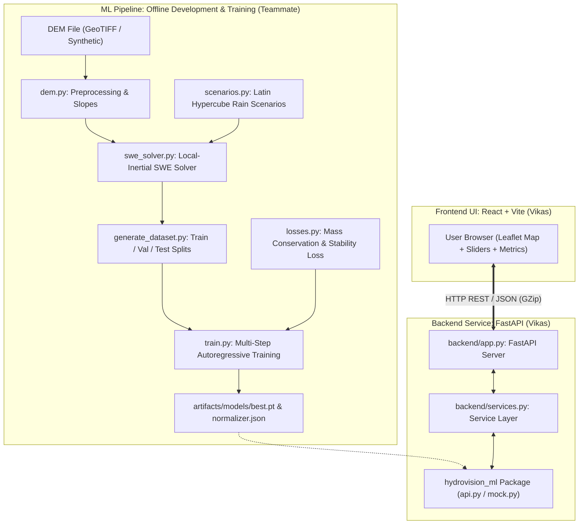

# HydroVision System Architecture

## 1. Overview

**HydroVision** is a physics-informed deep learning surrogate framework designed to deliver instant urban flood inundation forecasts on edge-accessible compute. Traditional two-dimensional hydrodynamic solvers (such as full Shallow Water Equation numerical schemes) require minutes to hours per storm scenario, rendering them unsuitable for live decision-support, real-time emergency routing, or interactive urban drainage planning. HydroVision answers Problem Statement **PS 1.2: Physics-Informed Neural Surrogate for Real-Time Urban Flood Forecasting** (Gradient Club, Department of AIML, BMS College of Engineering) by learning the spatial-temporal dynamics of surface runoff accumulation over high-resolution digital topography. It delivers high-accuracy 2-hour flood forecasts in milliseconds while enforcing strict physical conservation constraints (mass conservation and non-negative depths) and providing built-in verification against numerical ground truth.

---

## 2. System Architecture & Ownership Boundaries

The diagram below illustrates both the offline training pipeline and the online interactive serving pipeline. Subgraphs clearly delineate ownership boundaries between the ML Pipeline (ML Teammate), Backend API (Vikas), and Frontend UI (Vikas).

---

## 3. Data Flow Step-by-Step

### 3.1 Live Slider Change (`POST /forecast`)
1. **User Action**: The user adjusts a slider on the frontend UI (e.g., shifts `rain_intensity_mmhr` to $95\text{ mm/hr}$ or changes storm profile to `triangular`).
2. **Request Dispatch**: The frontend debounces the input (300 ms) and issues an HTTP `POST /forecast` with the JSON payload conforming to `ForecastRequest`.
3. **Validation & Routing**: FastAPI deserializes and validates parameters against Pydantic schemas (ensuring values fall within allowed ranges, e.g. intensity $\in [20, 150]$).
4. **Surrogate Rollout**: The service layer calls `hydrovision_ml.forecast(params)`. The model autoregressively rolls out 120 steps ($\Delta t = 60\text{ s}$), outputting 121 depth frames of size $64 \times 64$.
5. **Compression & Transmission**: The backend optionally subsamples via `frame_stride`, packages the response into `ForecastResponse`, and streams it via GZip middleware (< 500 KB compressed payload).
6. **Map Rendering**: The frontend decodes the payload, updates the Leaflet canvas overlay, and enables the user to scrub through the 2-hour flood timeline smoothly.

### 3.2 Numerical Verification (`POST /compare`)
1. **User Action**: The user clicks the **"Verify Against Solver"** button to validate the surrogate's accuracy on the active scenario.
2. **Request Dispatch**: The browser posts a `POST /compare` request containing the active scenario configuration.
3. **Dual Execution**: The backend invokes both the fast neural surrogate and the ground-truth numerical solver (`swe_solver.py`).
4. **Metric Calculation**: Upon solver completion, `compute_metrics()` computes spatial MAE, RMSE, peak depth error, wet IoU, mass conservation discrepancy, arrival time error, and empirical speedup factor.
5. **Comparison Presentation**: The frontend renders side-by-side synchronized raster overlays (Surrogate vs. Ground Truth) along with a metric scorecard.

---

## 4. Component Responsibility Matrix

| Component | Owner | Primary Responsibility | Inputs | Outputs |
|---|---|---|---|---|
| `hydrovision_ml/terrain` | Teammate | Ingest DEM, reproject, compute spatial slopes ($dz/dx, dz/dy$) | Raw GeoTIFF / Synthetic params | $64 \times 64$ elevation array, spatial bounds |
| `hydrovision_ml/solver` | Teammate | Numerical hydrodynamic simulation (2D local-inertial SWE) | DEM, hyetograph, infiltration rate | Depth frames sequence ($T \times 64 \times 64$), runtime |
| `hydrovision_ml/data` | Teammate | Sample storm scenarios, execute batch solver, save splits | Scenario distributions | `train.npz`, `val.npz`, `test.npz` |
| `hydrovision_ml/surrogate` | Teammate | Neural architecture, physics loss, unrolled training, rollout | Training splits, DEM, rainfall | Model checkpoint (`best.pt`), normalizer |
| `hydrovision_ml/eval` | Teammate | Benchmark metrics, speed profiling, publication plots | Predicted and true depth arrays | Metric dictionary, diagnostic figures |
| `backend/` | Vikas | REST API routing, CORS, GZip compression, mock/real toggle | Client JSON requests | Validated responses, error handling |
| `frontend/` | Vikas | Map rendering, time scrubber, rainfall controls, metrics | User interaction, API responses | Visualized flood inundation map |

---

## 5. Machine Learning Pipeline Specification

All ML modules described below are currently **PLANNED** for implementation in Phases 1 through 6.

### 5.1 Terrain Ingestion & Topographic Conditioning (PLANNED)
- **Grid Configuration**: Regular $64 \times 64$ mesh with spatial cell resolution $\Delta x = \Delta y = 40\text{ m}$ (catchment extent $\approx 2.56\text{ km} \times 2.56\text{ km}$).
- **Elevation Features**: In addition to raw topographic height $z_{i,j}$, the pipeline extracts spatial elevation gradients $\partial z / \partial x$ and $\partial z / \partial y$ using second-order central finite differences to explicitly encode gravitational drainage vectors into neural input channels.

### 5.2 Hydrodynamic Numerical Solver (PLANNED)
- **Governing Equations**: 2D simplified local-inertial formulation of the Shallow Water Equations (de Almeida & Bates, 2012):
  $$\frac{\partial h}{\partial t} + \frac{\partial q_x}{\partial x} + \frac{\partial q_y}{\partial y} = R - D$$
  $$q_x^{t+\Delta t} = \frac{q_x^t - g h \Delta t \frac{\partial(h+z)}{\partial x}}{1 + g \Delta t n^2 |q_x^t| / h^{7/3}}$$
- **Friction & Losses**: Manning roughness coefficient $n = 0.035$ representing mixed urban surface roughness; uniform infiltration/drainage sink rate $D$ representing urban drainage network intake.
- **Stability**: Internal sub-cycling with Courant-Friedrichs-Lewy (CFL) condition constraint ($\text{Cr} \le 0.7$).

### 5.3 Dataset Generation & Sampling (PLANNED)
- **Scenario Sampling**: Latin Hypercube Sampling (LHS) across 4 continuous and categorical dimensions:
  - Rainfall peak intensity: $I \in [20, 150]\text{ mm/hr}$
  - Rainfall storm duration: $T_{\text{rain}} \in [15, 90]\text{ minutes}$
  - Hyetograph shape: Constant, Triangular, Double-peak
  - Drainage sink capacity: $D \in [0, 30]\text{ mm/hr}$
- **Splits**: 100 simulation trajectories split into 70 train, 15 validation, 15 test scenarios, serialized to `artifacts/data/`.

### 5.4 Neural Surrogate Architecture (PLANNED)
- **Base Architecture (`UNetSurrogate`)**:
  - Input tensor shape: $(B, 5, 64, 64)$ containing:
    1. Water depth at previous time step: $h_t$
    2. Static elevation DEM: $z$
    3. Spatial gradient: $\partial z / \partial x$
    4. Spatial gradient: $\partial z / \partial y$
    5. Spatially broadcast net precipitation rate: $(R_t - D)$
  - Backbone: 4-level U-Net with residual convolutional blocks and skip connections.
  - Output tensor shape: $(B, 1, 64, 64)$ predicting depth increment $\Delta h_t$, enforcing $h_{t+1} = \max(0, h_t + \Delta h_t)$.
- **Conservative Flux Architecture (`ConservativeSurrogate`, Alternative)**:
  - Predicts directional cell-edge volumetric fluxes $(Q_x, Q_y)$ instead of raw depths, guaranteeing exact discrete mass conservation by construction.

### 5.5 Physics-Informed Losses & Autoregressive Stability (PLANNED)
- **Mass Conservation Loss**:
  $$\mathcal{L}_{\text{mass}} = \left| \sum_{i,j} h_{t+1, i, j} \Delta x \Delta y - \left( \sum_{i,j} h_{t, i, j} \Delta x \Delta y + (R_t - D)\Delta t \cdot \text{Area} \right) \right|$$
- **Non-Negativity Penalty**:
  $$\mathcal{L}_{\text{nonneg}} = \frac{1}{HW}\sum_{i,j} \left( \text{ReLU}(-h_{t+1, i, j}) \right)^2$$
- **Autoregressive Multi-Step Unrolling (Pushforward Trick)**:
  During training, rollout the surrogate for $k \in \{1, 3, 5, 10\}$ sequential steps feeding its own predictions back as input to mitigate error accumulation and runaway drift over the 120-step horizon.

---

## 6. Key Design Decisions

1. **No External Database**:
   - *Rationale*: A hackathon edge-first prototype must have zero operational overhead. All configurations live in `config.json`, weights in `artifacts/models/`, and static terrain in `artifacts/data/`.
2. **Deterministic Mock Mode (`HYDRO_MODE=mock`)**:
   - *Rationale*: Decouples frontend and backend engineering from model training. The frontend team can build, test, and style UI components using realistic synthetic data while the ML team trains models in parallel.
3. **Pure CPU Inference Optimization**:
   - *Rationale*: The surrogate has fewer than 1 million parameters, enabling full 120-step rollout in under 100 ms on a standard laptop CPU without requiring CUDA or dedicated GPUs.
4. **GZip Compression and Frame Striding**:
   - *Rationale*: A raw 121-frame $64 \times 64$ float matrix is $\approx 2\text{ MB}$ uncompressed. Applying GZip and offering an optional `frame_stride` reduces network payload size to $< 300\text{ KB}$, ensuring snappy web UI responsiveness.

---

## 7. Interface Contract Summary

Full contract specifications are defined in [`docs/CONTRACT.md`](CONTRACT.md). The 5 fundamental conventions are:

1. **Spatial Mesh**: $64 \times 64$ grid cells with regular spacing $\Delta x = \Delta y = 40.0\text{ m}$.
2. **Orientation**: Row 0 = North, Column 0 = West. Row index increases Southward; Column index increases Eastward.
3. **Physical Units**: Water depth in meters ($m$), rainfall in millimeters per hour ($mm/hr$), elevation in meters ($m$ a.s.l.).
4. **Temporal Horizon**: 120 steps at $\Delta t = 60\text{ s}$, resulting in exactly 121 output frames ($t=0$ through $t=7200\text{ s}$).
5. **Inundation Threshold**: Cells with depth $h \ge 0.05\text{ m}$ ($5\text{ cm}$) are classified as flooded.

---

## 8. Limitations & Assumptions

1. **Single Catchment Focus**: The spatial domain is calibrated for one urban neighborhood ($2.56\text{ km} \times 2.56\text{ km}$).
2. **Simplified Numerical Ground Truth**: The benchmark solver uses a 2D local-inertial approximation rather than full Navier-Stokes, omitting complex 1D pipe-network hydraulics.
3. **Synthetic Drainage Approximation**: Drain capacity is represented as a spatially uniform infiltration sink ($mm/hr$) rather than explicit storm inlet locations and capacity curves.
4. **Surrogate Emulates Solver, Not Nature**: The neural model learns to reproduce the numerical solver's output; any physics omitted by the solver will also be absent in the surrogate.
5. **Target Performance is Preliminary**: All reported performance metrics and speedup figures remain tentative until empirically measured in Phase 6.

---

## 9. Future Work

- **Road Network & Vulnerability Overlays**: Integrate OpenStreetMap road vector layers to highlight impassable roads ($h > 0.15\text{ m}$).
- **Ensemble & Uncertainty Quantification**: Train an ensemble of neural surrogates or employ MC-Dropout to visualize flood confidence intervals.
- **Multi-Catchment Generalization**: Extend model conditioning to arbitrary DEM patches using graph neural networks (GNNs) or Vision Transformers.
- **Real-Time Radar Rainfall Ingestion**: Stream live Doppler radar or IMD rainfall grids directly into the backend for continuous automated early warning.

